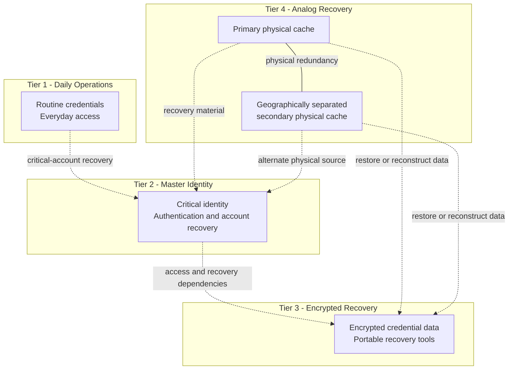

# PACE - Physical-Digital Security & Recovery Framework

*A modular personal-security architecture for resilient access, recovery, and graceful degradation.*

> **Status:** Personal implementation / architecture overview  
> **Scope:** Personal OPSEC, credential resilience, and recovery planning  
> **Version:** 2.1

## Overview

PACE (Primary, Alternate, Contingency, Emergency) is a modular framework for protecting access to critical digital identities, credentials, and recovery resources when devices, accounts, storage media, networks, or physical backups become unavailable.

The architecture combines four functional tiers:

1. **Daily Operational Environment** - routine credentials and everyday services.
2. **Master Identity Anchor** - protected identity and account-recovery control point.
3. **Encrypted Portable Recovery Environment** - portable encrypted data and recovery tools.
4. **Hardened Analog Recovery Layer** - physical recovery material maintained in separated locations.

These tiers are functional domains connected through alternative recovery paths, rather than a strictly linear chain.

The central design objective is **graceful degradation**: the loss of one component should not automatically result in the loss of the wider recovery environment.

## Architecture

### PACE roles and architectural tiers

PACE roles describe recovery priorities, while the four tiers describe functional security domains. They are related but not interchangeable.

- **Primary:** Normal route for accessing a resource or performing an operation.
- **Alternate:** Separate route available when the primary route is unavailable.
- **Contingency:** Recovery capability used when normal and alternate operations cannot continue.
- **Emergency:** Last-resort capability intended to preserve essential access under severe disruption.

A tier may support multiple PACE roles depending on the resource and failure scenario. Recovery paths should be assessed against their actual dependencies rather than assumed to be independent.

### Architecture diagram

The diagram illustrates conceptual relationships between the four tiers. Arrows represent potential recovery or support paths, not guaranteed functionality.

The diagram presents illustrative relationships. Actual recovery capabilities depend on the implementation, service-provider options, and shared dependencies. A connection between two tiers does not establish an independent recovery path.

## Design Principles

- **Compartmentalization:** Separate routine credentials from critical recovery resources.
- **Multi-path recovery:** Maintain alternative routes for restoring access and data.
- **Physical-digital redundancy:** Distribute recovery capability across digital storage, authentication methods, and physical records.
- **Offline capability:** Preserve essential recovery information without requiring continuous connectivity.
- **Geographic separation:** Avoid concentrating physical recovery material in one location.
- **Modularity:** Allow components to be replaced or extended independently.
- **Maintainability:** Use periodic checks and recovery exercises to identify failures.
- **Least disclosure:** Document architecture without exposing private recovery secrets or sensitive implementation details.

## Architectural Tiers

### Tier 1 - Daily Operational Environment

**Purpose:** Isolate routine digital activity from critical recovery infrastructure.

Typical scope:
- Routine and lower-criticality service credentials.
- Localized encrypted credential records.
- Everyday operational resources.

**Design objective:** Compromise of a routine account should not automatically expose the critical recovery environment.

### Tier 2 - Master Identity Anchor

**Purpose:** Provide a protected identity and recovery control point for critical digital assets.

Typical scope:
- Primary vault and critical-account recovery.
- High-value administrative, financial, or domain-related accounts.
- Authentication and recovery options for essential services.

Possible controls include hardware-backed authentication (FIDO2/WebAuthn or compatible U2F implementations), strong credentials, authenticator-specific PINs, and periodic account-recovery reviews.

The master identity anchor is a protected control point, **not the only recovery path**. Alternatives should remain available without depending exclusively on this account.

### Tier 3 - Encrypted Portable Recovery Environment

**Purpose:** Provide portable access to encrypted credentials and recovery tools.

Possible implementation choices:
- Encrypted credential databases or containers.
- Authenticated encryption such as AES-256 or ChaCha20-Poly1305 through reputable implementations.
- Argon2id for password-based key derivation.
- Portable tools that minimize installation requirements and plaintext persistence.

Portable execution and reduced host modification do not make an untrusted system safe. A compromised operating system may capture input or access plaintext after decryption.

### Tier 4 - Hardened Analog Recovery Layer

**Purpose:** Preserve recovery information when digital devices, accounts, or infrastructure are unavailable.

Possible implementation choices:
- Durable physical substrates and protective storage.
- Private obfuscation methods.
- Primary and geographically separated secondary physical caches.
- Periodic legibility, integrity, and storage-condition checks.

The specific personal obfuscation mechanism is intentionally excluded from public documentation. Concealment and obfuscation do not guarantee protection against inspection or coercion.

## Recovery Model

The framework is designed to preserve useful recovery capabilities when individual components become unavailable.

| Failure Scenario | Intended Recovery Approach |
|---|---|
| Primary physical cache lost or damaged | Use a separated secondary cache, if available and current. |
| Critical account inaccessible | Use another supported recovery route. |
| Master identity anchor unavailable | Use resources that do not depend exclusively on it. |
| Encrypted database unreadable | Restore from an independently maintained copy. |
| Network or provider outage | Use available offline resources. |
| Portable storage device lost | Reconstruct from an independent recovery source. |
| Authentication device lost | Use another provisioned authenticator or recovery method. |
| Localized physical disaster | Use geographically separated recovery material. |
| Multiple components unavailable | Use remaining viable paths, subject to their dependencies. |

### Redundancy and independence

Three distinctions are important:

- **Component redundancy:** Multiple copies or instances of a resource exist.
- **Path redundancy:** Multiple routes can restore or access a resource.
- **Failure independence:** An alternate route does not rely on the same failed dependency.

A recovery path is only independent to the extent that it avoids the unavailable account, key, device, provider, location, or other shared dependency.

These are design objectives, not universal guarantees. Service-provider recovery policies and technical limitations may constrain available options.

## Testing and Verification

Recovery capability should be evaluated through controlled exercises rather than assumed from the presence of backups or alternative components.

Illustrative test scenarios include:

| Test | Objective |
|---|---|
| Primary-source loss | Verify recovery without the normal recovery source. |
| Identity-anchor unavailability | Establish whether critical resources remain recoverable. |
| Encrypted-data recovery | Verify restoration from an independent copy. |
| Offline operation | Identify which essential operations remain possible without connectivity. |
| Physical-cache availability | Verify that alternate physical material remains accessible and usable. |
| Recovery-integrity check | Identify incomplete, damaged, or outdated recovery artifacts. |
| Dependency-isolation test | Identify recovery paths affected by shared dependencies. |

Tests should use controlled conditions and avoid unnecessary exposure of live credentials or recovery secrets.

For each exercise, maintain a private record of the scenario, expected outcome, observed outcome, result, and corrective actions.

The personal implementation has undergone recovery simulations. Detailed procedures, configuration-specific results, and sensitive recovery dependencies are intentionally withheld. Public examples describe test patterns rather than claiming that every listed scenario has been performed.

### Implementation Status

Capabilities can be tracked using the following distinctions:

- **Implemented** - present in the current deployment.
- **Tested** - exercised through a defined test.
- **Validated** - demonstrated to meet a stated requirement under documented conditions.
- **Optional** - dependent on the selected implementation.
- **Planned** - intended for future evaluation or development.

A successful test demonstrates the tested capability under the conditions exercised; it does not guarantee recovery under every possible failure.

## Threat Model and Limitations

PACE primarily addresses personal-security risks such as account loss, device loss, storage failure, provider outages, and localized physical damage.

| Threat | Intended Mitigation | Remaining Limitation |
|---|---|---|
| Routine account compromise | Compartmentalization and restricted access | Shared credentials or excessive privileges may permit escalation. |
| Loss of physical recovery material | Geographic separation and alternate sources | Correlated loss and outdated backups remain possible. |
| Untrusted host | Encrypted storage and minimized plaintext persistence | A compromised host may capture input or decrypted data. |
| Network outage | Offline recovery resources | Some provider operations still require connectivity. |
| Storage degradation | Integrity checks and independent copies | Failures may occur between checks. |
| Provider account loss | Alternative recovery resources | Provider-specific recovery policies still apply. |
| Master account compromise | Independent recovery paths | Shared dependencies must be identified and tested. |
| Physical inspection or coercion | Limited disclosure and private obfuscation | No concealment method guarantees protection in every scenario. |

PACE does not claim to eliminate all risks or provide certified protection against every hostile environment.

## Maintenance

Recovery components require periodic verification to remain usable.

Suggested activities:

- **Account review:** Check critical accounts, authentication methods, and recovery options.
- **Recovery drills:** Exercise supported recovery operations under controlled conditions.
- **Physical cache audits:** Check legibility, condition, and geographic separation.
- **Database integrity checks:** Verify encrypted data and independent copies.
- **Media maintenance:** Replace storage media based on condition and verification results.
- **Change review:** Re-test affected recovery paths after component or provider changes.

## Scalability and Extensibility

PACE is designed to accommodate changes without requiring a complete architectural redesign.

Possible extensions include:

- Alternative authentication devices and recovery methods.
- Additional encrypted storage and offline resources.
- Enhanced physical protection and geographically separated recovery material.
- Multi-user adaptations using role separation, multiple custodians, or threshold-based recovery mechanisms such as Shamir's Secret Sharing.
- Cryptographic component replacement as requirements and supported implementations evolve.

Any modification should preserve data recoverability and trigger re-evaluation of affected recovery paths. Cryptographic agility alone does not establish post-quantum readiness.

## Security and Disclosure

This repository is an architectural overview, not a deployment guide for a specific person's security setup.

It intentionally excludes:
- Actual credentials and recovery secrets.
- Private obfuscation mappings.
- Provider-specific account relationships.
- Sensitive recovery sequences and dependencies.
- Configuration details that could expose the private implementation.

Do not publish real recovery material or sensitive account information in issues, commits, screenshots, or documentation.

## License

Unless otherwise stated, documentation and diagrams in this repository are distributed under the **Creative Commons Attribution 4.0 International (CC BY 4.0)** license.

See [LICENSE](LICENSE) for the license notice and official legal text. This applies to documentation and diagrams only; software or code added to the repository should have its licensing scope identified separately. Third-party materials remain subject to their respective licenses.

---

**PACE is built around one principle:**

*The loss of an individual component should not automatically result in the loss of the wider recovery environment.*

By combining compartmentalization, physical-digital redundancy, alternative recovery paths, offline capability, and periodic verification, the framework aims to preserve access to critical resources when the primary route fails.
