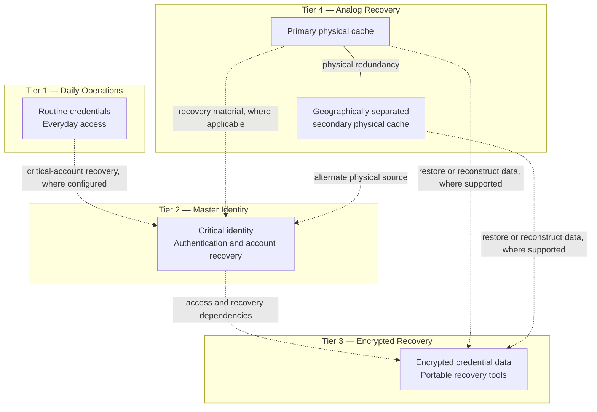

# PACE — Physical-Digital Security & Recovery Framework

*A modular personal-security architecture for resilient access, recovery, and graceful degradation.*

> **Status:** Architecture concept / personal implementation  
> **Scope:** Personal OPSEC, credential resilience, and recovery planning  
> **Version:** 2.1

## Overview

PACE (Primary, Alternate, Contingency, Emergency) is a modular framework for protecting access to important digital identities, credentials, and recovery resources when a device, account, storage medium, network connection, or physical backup becomes unavailable.

The framework combines four functional tiers:

1. **Daily Operational Environment** — routine credentials and lower-criticality services.
2. **Master Identity Anchor** — protected identity and account-recovery control point.
3. **Encrypted Portable Recovery Environment** — portable encrypted data and recovery tools.
4. **Hardened Analog Recovery Layer** — physical recovery material kept in separated locations.

These tiers are not intended to form a single, strictly linear chain. They are functional domains connected by alternative recovery paths. Depending on the failure, an available tier may help restore access to another tier or to a critical service.

The central design goal is **graceful degradation**: the loss of one component should not automatically cause the loss of the wider recovery environment.

### PACE roles and architectural tiers

PACE describes recovery roles; the four tiers describe functional security domains. They are related, but they are not interchangeable.

* **Primary:** The normal, intended route for accessing a resource or performing an operation.
* **Alternate:** A separate route available when the primary route is unavailable.
* **Contingency:** A recovery capability used when normal and alternate operations cannot continue.
* **Emergency:** A last-resort capability intended to preserve or restore essential access under severe disruption.

The four tiers organize credentials, identity controls, encrypted recovery resources, and physical recovery material. A tier may support more than one PACE role, depending on the resource and failure scenario.

PACE roles should be assigned to specific recovery scenarios rather than permanently equated with individual tiers. A recovery path qualifies as alternate or independent only to the extent that it avoids the relevant failed dependencies.

The labels describe design intent; their effectiveness depends on implementation and testing.

## Architecture at a glance

The graph below shows the conceptual relationships between tiers. Arrows represent potential recovery or support paths, not a guarantee that every path works for every service. Actual dependencies depend on the implementation and the recovery options supported by each provider.

The diagram presents functional domains and illustrative recovery relationships. The solid line indicates physical redundancy between the two physical caches; dashed arrows indicate potential recovery or dependency relationships where supported by the implementation. The arrows are not guarantees that recovery works in both directions or remains available under every failure scenario.

The links are conceptual examples, not a claim that every path exists in every deployment. Remove or relabel any link that does not match the implementation. A connection between two tiers is not, by itself, proof of an independent recovery path.

## Design principles

- **Compartmentalization:** Routine credentials are separated from critical recovery resources.
- **Multi-path recovery:** More than one route may be available to recover a credential, account, or data set.
- **Physical-digital redundancy:** Recovery capability is distributed across digital storage, authentication methods, and physical records.
- **Offline capability:** Essential recovery information is retained in a form that does not always require internet access.
- **Geographic separation:** Physical recovery material is not concentrated in one location.
- **Modularity:** Components can be replaced or extended without redesigning the entire framework.
- **Maintainability:** Periodic checks and recovery drills are used to find failures before an emergency.
- **Least disclosure:** Public documentation describes the architecture without publishing private recovery secrets or sensitive implementation details.

## Tiers

### Tier 1 — Daily Operational Environment

**Purpose:** Isolate routine digital activity from critical recovery infrastructure.

**Typical scope**
- Routine and lower-criticality service credentials.
- Localized encrypted credential records.
- Everyday operational resources.

**Controls**
- Separate routine credentials from master recovery credentials.
- Limit unnecessary connections between routine accounts and critical identity assets.
- Use offline reference material where appropriate for the personal implementation.

**Design objective:** Compromise of a routine account should not automatically expose the critical recovery environment.

### Tier 2 — Master Identity Anchor

**Purpose:** Provide a protected identity and recovery control point for critical digital assets.

**Typical scope**
- Primary vault and critical-account recovery.
- High-value administrative, financial, or domain-related accounts.
- Authentication and recovery options for essential services.

**Controls**
- Hardware-backed authentication such as FIDO2/WebAuthn or compatible U2F implementations, where supported.
- Strong credentials and authenticator-specific PIN/passphrase controls where applicable.
- Scheduled account checks to identify inactivity policies or changes to recovery options.
- Optional product- or application-specific duress or decoy features.

The master identity anchor is a protected control point, **not intended to be the only recovery path**. The deployment should preserve alternatives that do not depend exclusively on this account.

### Tier 3 — Encrypted Portable Recovery Environment

**Purpose:** Provide portable access to encrypted credentials and recovery tools.

**Possible implementation choices**
- An encrypted credential database or container.
- Authenticated encryption such as AES-256 or ChaCha20-Poly1305 through a reputable implementation.
- Argon2id for password-based key derivation, configured for the target hardware and acceptable unlock time.
- Portable tools that run without installation where the operating system permits.
- Minimization of plaintext persistence and unnecessary host modification.

Portable execution and user-space permissions reduce some forms of exposure but do not make a compromised host trustworthy. An actively compromised operating system may capture input or plaintext after decryption. Host restrictions and cross-platform support also vary.

### Tier 4 — Hardened Analog Recovery Layer

**Purpose:** Preserve recovery information when digital devices, accounts, or infrastructure are unavailable.

**Possible implementation choices**
- Durable, water-resistant physical substrates and protective storage.
- A private obfuscation method intended to limit disclosure if physical records are discovered.
- A primary physical cache and a geographically separated secondary cache.
- Periodic legibility, integrity, and storage-condition checks.

The specific personal obfuscation mechanism is intentionally not documented publicly. Concealment and obfuscation can reduce disclosure risk, but should not be represented as a universal guarantee against inspection or coercion.

Any emergency physical-protection or destruction mechanism is implementation-specific and should be assessed separately for safety and effectiveness.

## Recovery model: graceful degradation

The framework is designed so that the loss of one component does not automatically invalidate all other components.

| Failure scenario | Intended recovery approach |
|---|---|
| Primary physical cache lost or damaged | Use the separated secondary cache, if available and current. |
| Critical account becomes inaccessible | Use the master identity anchor or another supported independent recovery route. |
| Master identity anchor unavailable | Use recovery resources that do not depend exclusively on that account. |
| Encrypted database becomes unreadable | Restore from an independently maintained copy or alternate recovery material. |
| Network or provider outage | Use available offline resources and defer actions that require connectivity. |
| Portable storage device lost | Reconstruct the environment from an independent recovery source. |
| Authentication device lost | Use another authenticator or recovery method provisioned for the service. |
| Localized physical disaster | Use geographically separated recovery material. |
| Multiple components unavailable | Use the remaining viable paths, subject to their dependencies and current state. |

These are **design objectives**, not universal guarantees. Some services impose recovery requirements that cannot be bypassed by a local architecture.

### Redundancy versus independence

- **Component redundancy:** More than one copy or instance of a resource exists.
- **Path redundancy:** More than one route can reach or reconstruct a resource.
- **Failure independence:** An alternate route does not rely on the same failed dependency.
- **Graceful degradation:** The system retains useful capability while operating with fewer components.

A recovery route is only independent to the extent that it does not rely on the same unavailable account, key, device, provider, location, or remembered secret. Mapping these dependencies is an important part of validating the architecture.

## Illustrative recovery test patterns

This section describes **what kinds of failure to simulate**. The examples below are generic test patterns, not the exact procedures, configuration, or results of any particular deployment.

Tests should be performed in a controlled manner, using safe test conditions and avoiding unnecessary exposure of live credentials or recovery secrets.

| Test pattern | Failure condition | Expected result |
|---|---|---|
| Primary-source loss | The normal recovery source is treated as unavailable. | A supported alternate source can restore the intended capability without relying on the missing source. |
| Identity-anchor unavailability | The primary identity or account-recovery control point cannot be used. | Essential recovery remains possible through a previously provisioned alternative, where supported. |
| Encrypted-data recovery | The normal copy of a protected data set is unavailable or unusable. | An independent copy or recovery source can restore readable, usable data. |
| Offline-operation test | Network access is unavailable. | Operations designated as offline-capable can be completed without connectivity; network-dependent actions are identified separately. |
| Physical-cache availability | One physical recovery location is unavailable. | The separated source remains accessible, legible, and usable for its intended purpose. |
| Recovery-integrity test | A backup or recovery artifact may be incomplete, outdated, or damaged. | Integrity and usability checks identify whether it can still support recovery. |
| Dependency-isolation test | A component shared by multiple recovery paths is unavailable. | The test identifies which paths remain viable and which fail because of the shared dependency. |
| Recovery-maintenance test | A component or provider configuration has changed. | Affected recovery paths are rechecked before the updated configuration is relied upon. |

### Recording results without disclosing secrets

For each test, retain a private record containing the scenario, test date, expected outcome, observed outcome, pass/fail status, and any limitations or corrective actions.

Public documentation can report aggregate outcomes or sanitized summaries. It should not include live credentials, secret mappings, recovery sequences, identifying account relationships, or details that would allow an outsider to reconstruct the private configuration.

A successful test demonstrates the tested capability under the conditions exercised; it does not establish that every recovery path will work under every possible failure.

Only mark a capability as tested or validated when the corresponding evidence supports that status.

**Verification note:** The personal implementation has undergone recovery simulations. Detailed procedures, configuration-specific results, and sensitive recovery dependencies are intentionally withheld. Public test descriptions are illustrative and do not constitute a claim that every listed test has been performed.

## Threat model and limitations

The framework is intended primarily for personal security and resilience against foreseeable events such as account loss, device loss, storage failure, provider outages, and localized physical damage.

It does not claim to eliminate all risks or to provide certified protection against every hostile environment.

| Threat | Intended mitigation | Remaining limitation |
|---|---|---|
| Routine account compromise | Compartmentalization and restricted access to critical recovery assets | Shared credentials or excessive privileges can permit escalation. |
| Loss of physical recovery material | Geographic separation and alternate recovery paths | Correlated loss or stale backups remain possible. |
| Untrusted host | Encrypted storage, minimized persistence, and reduced host interaction | A compromised host may capture input or decrypted data. |
| Network outage | Offline recovery resources | Some provider operations still require connectivity. |
| Storage degradation | Integrity checks, independent copies, and recovery drills | Failures may occur between checks. |
| Provider account loss | Alternative recovery resources | Provider-specific recovery policies still apply. |
| Master account compromise | Recovery resources independent of the master account | Shared dependencies must be identified and tested. |
| Physical inspection or coercion | Limited disclosure and private obfuscation methods | No concealment method guarantees protection in every coercive scenario. |

## Maintenance and recovery testing

This section describes **what to check periodically**, rather than listing individual failure simulations.

A recovery design is only useful if its components remain available and the operator can use them correctly.

Suggested maintenance activities:

- **Account review:** Check critical accounts, recovery options, authentication methods, and inactivity policies on a scheduled basis.
- **Cold recovery drills:** Periodically test supported recovery operations without relying on the normal network connection.
- **Failure simulation:** Where safe, test recovery after making one component unavailable at a time.
- **Physical cache audits:** Check legibility, condition, seals, and geographic separation.
- **Database integrity checks:** Verify that encrypted data and independent copies remain readable.
- **Media maintenance:** Refresh or replace storage media based on test results, condition, and manufacturer guidance.
- **Change review:** Re-test affected recovery paths after changing a component, credential format, encryption implementation, or provider.

## Implementation status and verification

This section describes **how to label implementation and evidence**. It is separate from the illustrative test catalogue and recurring maintenance checklist.

This repository documents an architecture and its design goals. The exact capabilities and evidence vary by implementation.

For clarity, each capability can be tracked using these statuses:

- **Implemented** — present in the current deployment.
- **Tested** — exercised through a defined test.
- **Validated** — shown to meet a stated requirement under documented conditions.
- **Optional** — available only in implementations that support it.
- **Planned** — intended for future evaluation or development.

Useful verification questions include:

1. Can the primary physical cache be lost without losing all recovery capability?
2. Can critical resources be recovered if the master identity anchor is unavailable?
3. Can the portable environment be restored from an independent source?
4. Can essential offline procedures be completed without network access?
5. Are alternate paths genuinely independent of the component being tested?
6. Can the operator still interpret and use the physical recovery material after an extended period?
7. Do recovery procedures continue to work after a component is upgraded?

Sensitive implementation details and recovery secrets are intentionally excluded from public documentation. Test descriptions should report the scenario, expected outcome, observed outcome, and limitations without exposing operational secrets.

## Scalability and extensibility

### Modular replacement

Authentication devices, encrypted storage tools, physical substrates, and other components can be replaced independently, provided that existing data remains recoverable and affected paths are re-tested.

### Optional modules

Implementations may add or omit controls based on their threat model, including alternative authenticators, application-specific duress features, additional offline databases, and enhanced physical protection.

### Multi-user adaptation

A team-oriented adaptation could introduce multi-custodian procedures, role separation, and threshold-based recovery mechanisms such as Shamir's Secret Sharing. These require additional policies for authorization, revocation, and recovery coordination.

### Cryptographic agility

Cryptographic components should be replaceable as requirements evolve. Migration must account for existing encrypted data, key derivation, authentication, recovery compatibility, and implementation support. Cryptographic agility does not by itself establish post-quantum readiness.

## Security and disclosure note

This repository is an architectural overview, not a deployment guide for a specific person's security setup. It intentionally excludes actual credentials, recovery secrets, private obfuscation mappings, provider-specific account relationships, and other sensitive operational details.

Do not publish real recovery material, secret mappings, or screenshots that expose private account relationships in issues, commits, or documentation.

## Plain-language glossary

* **Compartmentalization:** Keeping routine accounts and critical recovery resources separate so a problem in one area is less likely to spread to others.
* **Recovery path:** A route for restoring access or capability when the normal method fails.
* **Independent recovery:** A recovery route that does not rely on the same component or dependency that has failed.
* **Graceful degradation:** Retaining useful capabilities even when part of the system is unavailable.
* **Threat model:** A description of the failures, risks, or adversarial situations the design aims to address.
* **Authenticated encryption:** Encryption that also helps detect unauthorized changes to protected data.
* **Key derivation:** The process of deriving cryptographic key material from a password or other input.
* **Recovery drill:** A controlled exercise that checks whether a recovery procedure works as intended.

## License

Unless otherwise stated, the documentation and diagrams in this repository are made available under the **Creative Commons Attribution 4.0 International (CC BY 4.0)** license. You may share and adapt those materials, including commercially, subject to the license terms and attribution requirements.

See [`LICENSE`](LICENSE) for a license notice and a link to the official legal text. This notice applies to documentation and diagrams only; any software or code added to the repository should have its licensing scope stated separately. Third-party materials remain subject to their own licenses.

## Summary

PACE is a modular personal-security framework built around one principle:

**The loss of an individual component should not automatically result in the loss of the wider recovery environment.**

By combining compartmentalization, physical-digital redundancy, multiple recovery paths, offline capability, and periodic verification, the framework aims to preserve access to critical resources when the primary route fails.

Its tiers define functional security domains; its recovery paths define how those domains support one another; and its maintenance and testing practices help establish whether the intended resilience is actually achieved.
